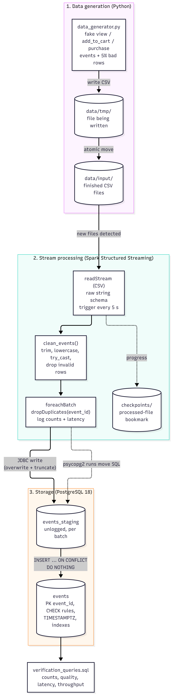

# Real-Time Data Ingestion with Spark Structured Streaming & PostgreSQL

A real-time pipeline that simulates e-commerce user activity (views, add-to-cart, purchases),
streams the generated CSV files with **Spark Structured Streaming**, cleans and de-duplicates them,
and stores them in **PostgreSQL**, typically within a few seconds of each event.



## Results at a glance

| Measure | Result |
|---|---|
| Data loss | **0 rows** in every test run (generator = Spark log = PostgreSQL), e.g. 10,000 events → 743 invalid dropped, 151 duplicates removed → **9,257 stored** |
| Re-processing safety | Replaying an already-processed file → `0 inserted`, no error (idempotent write) |
| End-to-end latency (5 s trigger) | Average **6.8 s**, about 90% of it waiting for the trigger |
| End-to-end latency (2 s trigger) | Average **3.0 s** (−55%) |
| Throughput (2,000-event files) | **690–1,080 rows/s** per micro-batch after warm-up |
| Test plan | **20/20** manual test cases passed |

Full details: [test cases](docs/test_cases.md) · [performance report](docs/performance_metrics.md)

## Tech stack (tested versions)

| Tool | Version | Notes |
|---|---|---|
| Windows | 10/11, 64-bit | Native install, no Docker |
| Python | 3.14.8 | Virtual environment in `.venv` |
| PySpark | 4.3.0 | Pinned in `requirements.txt` |
| psycopg2-binary | 2.9.13 | Runs the `INSERT ... ON CONFLICT` merge step |
| Java (JDK) | Eclipse Temurin 25.0.5 | `JAVA_HOME` must point to it |
| Hadoop Windows helpers | `winutils.exe` + `hadoop.dll` | In `C:\hadoop\bin` (`HADOOP_HOME=C:\hadoop`, `C:\hadoop\bin` on `PATH`) |
| PostgreSQL | 18.6 | Port 5432, managed with pgAdmin 4 |
| PostgreSQL JDBC driver | 42.7.7 | Downloaded automatically by Spark on first run |

## Project structure

```
real-time-ingestion/
├── README.md
├── requirements.txt                    # pinned Python packages
├── postgres_connection_details.txt     # host, port, database, lab user, password
├── src/
│   ├── data_generator.py               # Part 1: fake e-commerce events as CSV files
│   └── spark_streaming_to_postgres.py  # Parts 2–3: stream, clean, write to PostgreSQL
├── sql/
│   ├── postgres_setup.sql              # lab user, database, events + staging tables
│   └── verification_queries.sql        # counts, data quality, latency, throughput
├── scripts/
│   └── run_demo.ps1                    # one-command demo with PASS/FAIL checks
└── docs/
    ├── system_architecture.png         # diagram (source: system_architecture.mmd)
    ├── system_architecture.mmd
    ├── project_overview.md
    ├── user_guide.md
    ├── test_cases.md
    └── performance_metrics.md
```

`data/`, `checkpoints/`, `.venv/` and IDE folders are created at run time and excluded by `.gitignore`.

## Quick start

Full instructions, options and troubleshooting: **[docs/user_guide.md](docs/user_guide.md)**.

```powershell
# 1. Environment
python -m venv .venv
.venv\Scripts\activate
pip install -r requirements.txt

# 2. Database (asks for the postgres admin password)
& "C:\Program Files\PostgreSQL\18\bin\psql.exe" -U postgres -f sql\postgres_setup.sql

# 3. Terminal 1: start the streaming job
python src\spark_streaming_to_postgres.py

# 4. Terminal 2: generate events
python src\data_generator.py --events 100 --interval 8 --batches 5

# 5. Check the results (password: spark_lab_pass)
& "C:\Program Files\PostgreSQL\18\bin\psql.exe" -h localhost -U spark_user -d ecommerce_events -f sql\verification_queries.sql
```
**Or run everything in one command** (reset, Spark, generator, checks, replay and restart tests, clean-up):

```powershell
.\scripts\run_demo.ps1            # add -Pause to step through it live
```

It ends with a PASS/FAIL summary. Details: [user guide, section 5](docs/user_guide.md#5-automated-demo-and-checks).

## How it works

1. **Generate:** `data_generator.py` writes each batch of events to `data/tmp/`, then moves the finished
   file into `data/input/`, so Spark never sees a half-written file. `--bad-rate` injects counted
   data-quality problems for testing.
2. **Stream:** Spark watches `data/input/` with a 5 s trigger; a checkpoint ensures each file is read once.
3. **Clean:** every column is read as text, then converted with `try_cast` / `try_to_timestamp`
   (ANSI-safe), `event_type` is trimmed and lowercased, and invalid rows are dropped.
4. **De-duplicate and store:** inside `foreachBatch`, duplicates are removed, the batch is written to an
   unlogged staging table via JDBC, and `INSERT ... ON CONFLICT (event_id) DO NOTHING` moves only new
   events into `events`.
5. **Measure:** each batch logs rows in / invalid / duplicates / inserted, latency and Spark's throughput
   metrics; `verification_queries.sql` reports end-to-end latency from `stored_at − event_time`.

### Key design choices

| Choice | Reason |
|---|---|
| Write to `tmp/`, then move | Atomic hand-off: no partial files |
| Read as text, `try_cast` | Bad values are counted and dropped instead of crashing the stream (Spark 4 ANSI mode) |
| Staging table + `ON CONFLICT DO NOTHING` | Idempotent writes: a re-run batch cannot cause duplicate-key failures |
| `NUMERIC(10,2)` / `decimal(10,2)` | Exact money values |
| `TIMESTAMPTZ` | Correct latency even when Spark and PostgreSQL use different time zones |
| Separate `spark_user` | Least privilege: the job can only access its own database |
| CHECK constraints mirroring Spark rules | Defence in depth |

More detail: **[docs/project_overview.md](docs/project_overview.md)**.

## Deliverables

| Assignment deliverable | File |
|---|---|
| `data_generator.py` | [`src/data_generator.py`](src/data_generator.py) |
| `spark_streaming_to_postgres.py` | [`src/spark_streaming_to_postgres.py`](src/spark_streaming_to_postgres.py) |
| `postgres_setup.sql` | [`sql/postgres_setup.sql`](sql/postgres_setup.sql) |
| `postgres_connection_details.txt` | [`postgres_connection_details.txt`](postgres_connection_details.txt) |
| `project_overview.md` | [`docs/project_overview.md`](docs/project_overview.md) |
| `user_guide.md` | [`docs/user_guide.md`](docs/user_guide.md) |
| `test_cases.md` | [`docs/test_cases.md`](docs/test_cases.md) |
| `performance_metrics.md` | [`docs/performance_metrics.md`](docs/performance_metrics.md) |
| `system_architecture.png` | [`docs/system_architecture.png`](docs/system_architecture.png) |
| Extra | [`sql/verification_queries.sql`](sql/verification_queries.sql), [`docs/system_architecture.mmd`](docs/system_architecture.mmd) |
| Extra | [`sql/verification_queries.sql`](sql/verification_queries.sql), [`docs/system_architecture.mmd`](docs/system_architecture.mmd), [`scripts/run_demo.ps1`](scripts/run_demo.ps1) |