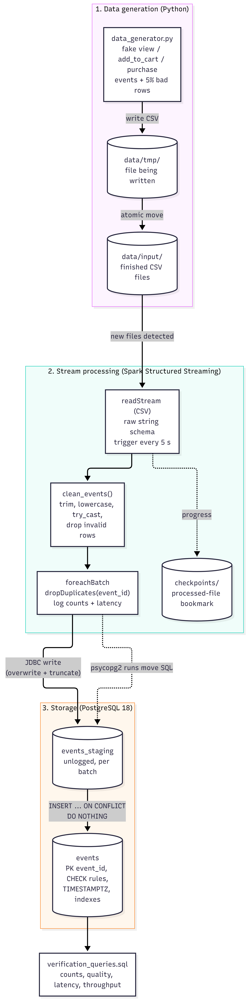

# Project Overview: Real-Time E-Commerce Event Ingestion

## 1. Purpose

This project simulates an online shop's user activity (product views, add-to-cart actions
and purchases) and processes it **in near real time**. New events are written as CSV files,
picked up by **Spark Structured Streaming**, cleaned and validated, and stored in
**PostgreSQL**, where they can be queried within seconds of happening.

## 2. Architecture

The editable source of the diagram is [`system_architecture.mmd`](system_architecture.mmd) (Mermaid).

## 3. Components

| Component | File / object | Responsibility |
|---|---|---|
| Event generator | `src/data_generator.py` | Creates fake events and writes one CSV file per batch. Can inject a configurable share of bad rows (`--bad-rate`) to test cleaning |
| Landing folders | `data/tmp/` → `data/input/` | Files are written in `tmp` and **moved** into `input` when complete, so Spark never reads a half-written file |
| Streaming job | `src/spark_streaming_to_postgres.py` | Watches `data/input/`, cleans each micro-batch, removes duplicates, writes to PostgreSQL and logs metrics |
| Checkpoint | `checkpoints/events_to_postgres/` | Spark's record of which files were processed, so nothing is read twice after a restart |
| Staging table | `events_staging` (unlogged) | Holds the current micro-batch before it is merged into `events` |
| Events table | `events` | Final, clean store: primary key, CHECK rules, indexes |
| Setup script | `sql/postgres_setup.sql` | Creates the lab user, database and both tables |
| Verification queries | `sql/verification_queries.sql` | Row counts, data-quality checks, latency and throughput |
| Connection settings | `postgres_connection_details.txt` | Host, port, database, lab user and password, read by the Spark job |

## 4. Data flow (life of one event)

1. **Generate**: `data_generator.py` creates an event, e.g. *user 42 viewed product 101 at 12:00:00.123*,
   with a unique `event_id` (UUID).
2. **Land**: the event is written with others into `data/tmp/events_<timestamp>.csv`; the finished file is
   moved into `data/input/`.
3. **Detect**: every 5 seconds (trigger), Spark checks `data/input/` and reads only the **new** files.
4. **Clean**: `clean_events()` trims text, lowercases `event_type`, converts types with `try_cast` /
   `try_to_timestamp`, and drops rows that break a rule.
5. **De-duplicate**: inside `foreachBatch`, rows with the same `event_id` are reduced to one.
6. **Stage**: the batch is written to `events_staging` through JDBC (table emptied, then refilled).
7. **Merge**: `INSERT INTO events ... SELECT ... FROM events_staging ON CONFLICT (event_id) DO NOTHING`
   adds only events that are not already stored.
8. **Record**: PostgreSQL stamps `stored_at`; Spark logs rows in / dropped / inserted and latency.

## 5. Data model: `events`

| Column | Type | Rule |
|---|---|---|
| `event_id` | `VARCHAR(36)` | Primary key (UUID) |
| `event_time` | `TIMESTAMPTZ` | When the user acted |
| `user_id` | `INTEGER` | Not null, > 0 |
| `event_type` | `VARCHAR(20)` | `view`, `add_to_cart` or `purchase` |
| `product_id` | `INTEGER` | Not null |
| `product_name`, `category` | `VARCHAR` | Descriptive, optional |
| `price` | `NUMERIC(10,2)` | Not null, ≥ 0 |
| `quantity` | `INTEGER` | Not null, > 0 |
| `ingested_at` | `TIMESTAMPTZ` | When Spark processed the micro-batch |
| `stored_at` | `TIMESTAMPTZ` | When PostgreSQL saved the row (default `CURRENT_TIMESTAMP`) |

Indexes: `event_time`, `event_type` (plus the primary key on `event_id`).

## 6. Data quality rules

| Problem in the CSV | Example | Action |
|---|---|---|
| Missing user | `user_id` empty | Dropped |
| Negative price | `-49.99` | Dropped |
| Non-numeric price | `abc` | Dropped (`try_cast` returns null) |
| Unknown event type | `refund` | Dropped |
| Unreadable timestamp | `not-a-date` | Dropped (`try_to_timestamp` returns null) |
| Messy event type | `"  VIEW "` | **Fixed** (trim + lowercase) and kept |
| Duplicate event | Same `event_id` twice | One copy kept |

The same rules are enforced again by PostgreSQL CHECK constraints (defence in depth).

## 7. Reliability

| Situation | What happens |
|---|---|
| Spark is restarted | The checkpoint remembers processed files; nothing is re-read |
| A batch is processed twice (crash and retry, or a copied file) | `ON CONFLICT DO NOTHING` skips existing `event_id`s: **0 inserted, no error** |
| A value cannot be converted | `try_cast` gives null and the row is dropped; the stream keeps running |
| PostgreSQL is down or the password is wrong | The job checks the connection at start-up and fails fast with a clear error |

## 8. Key design decisions

| Decision | Why | Alternative considered |
|---|---|---|
| Write files to `tmp/`, then move to `input/` | A move is atomic, so Spark never reads a partial file | Writing directly into `input/` (risk of half-read files) |
| Read every CSV column as text first | Lets the job see and count bad values instead of Spark silently turning them into nulls | Typed schema on read |
| `try_cast` / `try_to_timestamp` | Spark 4 runs in ANSI mode, where a plain `cast` **fails the whole stream** on one bad value | `cast` / `to_timestamp` |
| `foreachBatch` | Allows counting, de-duplication and a two-step write per batch | Built-in streaming sinks (no custom logic) |
| De-duplicate per batch + primary key | Simple, with no ever-growing streaming state; the database catches anything across batches | Streaming `dropDuplicates` with a watermark |
| Staging table + `ON CONFLICT DO NOTHING` | Makes writes **idempotent**: a re-run batch can't crash the job | Plain JDBC `append` (fails on the first duplicate key) |
| `NUMERIC(10,2)` / `decimal(10,2)` for price | Exact money values | `double` (rounding errors) |
| `TIMESTAMPTZ` | Latency is correct even if the database and Spark use different time zones | `TIMESTAMP` (gave −2 h latencies in testing) |
| Separate `spark_user` | Least privilege: the job can only touch its own database | Using the `postgres` superuser |
| Spark 4.3 / Java 25 | Versions already proven on this machine in an earlier lab | Spark 3.5 / Java 17 |

## 9. Limitations and next steps

| Limitation | Possible improvement |
|---|---|
| Runs in Spark local mode on one machine | Run on a cluster (YARN, Kubernetes) for higher volume |
| Invalid rows are dropped and only counted | Write them to a `rejected_events` table for later inspection |
| Single writer: one stream uses the staging table | Use one staging table per batch (or per query) if several streams run in parallel |
| The lab password is stored in a text file | Use environment variables or a secrets manager in production |
| Latency is mostly the trigger wait (see `performance_metrics.md`) | A shorter trigger, or a message queue such as Kafka instead of files |
| Windows setup needs `winutils.exe` / `hadoop.dll` | Run in Docker or on Linux |